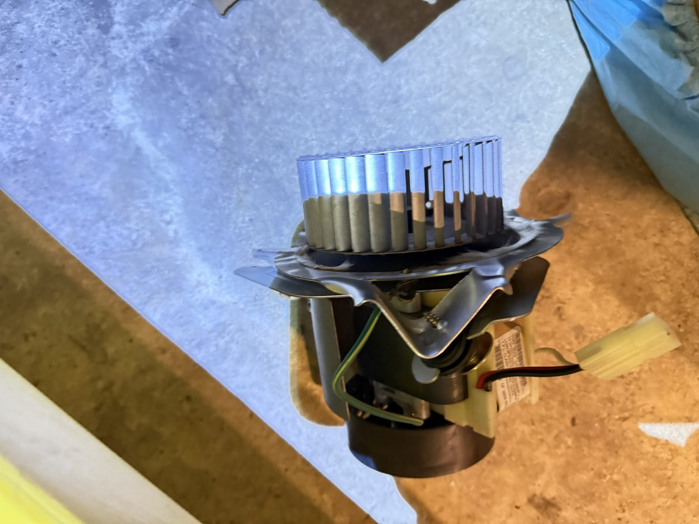
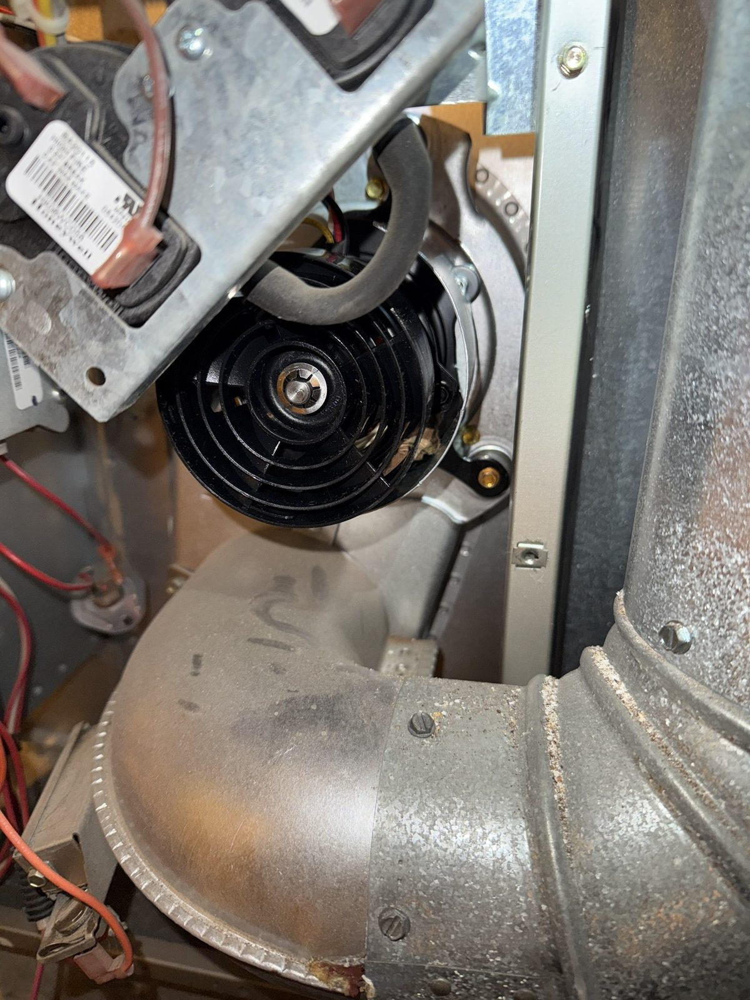

The furnace clicks on, you hear a fan start, and then nothing. No flame. A minute later it tries again. On a lot of service calls like that, the part at fault is the **draft inducer motor**, and that's the part we replaced today on a gas furnace in [Lincolnwood](/hvac-lincolnwood/), next to Skokie.

## What the inducer does

Every modern gas furnace has a small fan mounted near the flue pipe, separate from the big blower that moves air through your house. That's the inducer. When the thermostat calls for heat, it runs first and pulls the exhaust through the heat exchanger and out the vent.

A **pressure switch** watches for that draft. Only when the switch closes does the control board open the gas valve and light the burners. It's a safety chain: if the exhaust can't get out, the furnace doesn't light.

So when the inducer motor fails, the furnace doesn't run badly. It doesn't run at all.

## Signs the inducer motor is going

- **Noise at startup.** A high whine, grinding or rattle in the first few seconds, before the burners light. Worn bearings usually get louder for a while before the motor stops.
- **A hum, but the fan doesn't spin.** The motor is getting power and can't turn.
- **The furnace tries, quits, and tries again,** then locks out after a few attempts.
- **A pressure switch code** on the control board's blinking light. The code chart is usually on the inside of the furnace door.
- **No heat at all,** with the thermostat calling and the furnace switch on. Our guide on [a furnace that won't turn on](/furnace-wont-turn-on/) covers the other causes.

## Test before you replace

A pressure switch code doesn't automatically mean a bad motor. The same symptom comes from:

- a **blocked vent or intake**, like snow over a sidewall vent (see [furnace vent blocked by snow](/furnace-vent-blocked-by-snow/)), a bird's nest, or ice;
- a **cracked or water-filled hose** between the inducer and the pressure switch;
- a **clogged condensate drain** on a high-efficiency furnace, which backs water into the inducer housing;
- a **failed pressure switch**;
- a **bad wire or control board** that isn't sending power to the motor.

We check those first: power at the motor, whether the wheel turns freely, the hose and port, the drain, the vent, and the pressure the inducer actually pulls. Buying a motor for a furnace that has a plugged vent fixes nothing.

## Motor or the whole assembly?

On some furnaces the motor can be replaced by itself. On many, the manufacturer sells the inducer only as a complete assembly: motor, wheel and housing together, with a new gasket. Either way, the gasket matters. This is the part that keeps exhaust in the vent system, so the new one has to seal properly. After the swap we run the furnace through full heating cycles and watch the pressure switch close, the flame, and the venting.

## What changes the cost

There's no single price, because it depends on:

- the **furnace brand and model** and what the manufacturer sells (motor only, or full assembly);
- whether it's an **original-manufacturer part** or an approved universal replacement;
- **access**, since a basement furnace is quicker than a horizontal furnace squeezed into an attic;
- whether **anything else** failed with it, like the pressure switch or a hose.

We diagnose first and give you the price before any work starts. If the furnace is old enough that replacement deserves a look, we'll price that too. Here's [how we think about repair vs. replace](/repair-or-replace-furnace/).

## What you can safely do

- **Check the vent and intake outside** for snow, ice or a nest, if your furnace vents through the wall.
- **Read the blink code** through the window on the furnace door and write it down. It speeds up the service call.
- **Turn the furnace off** if the inducer is screeching or grinding, and call. A motor that seizes can take the furnace down on the coldest night of the week.
- **Don't jumper or bypass the pressure switch.** That switch is the proof the exhaust is leaving the house. The U.S. Consumer Product Safety Commission [recommends a professional inspection of furnaces, flues and vents every year](https://www.cpsc.gov/Newsroom/News-Releases/2025/Theres-a-Chill-in-the-Air-Stay-Warm-Safely-Be-Cautious-When-Using-Generators-Furnaces-and-Space-Heaters), and a working CO alarm on every level of the home.

A yearly [furnace tune-up](/furnace-tune-up/) is when a noisy inducer gets caught early. ENERGY STAR's [maintenance checklist](https://www.energystar.gov/saveathome/heating-cooling/maintenance-checklist) includes checking the furnace's electrical connections and motors for the same reason.

Furnace humming, whining, or trying to start and giving up? [Schedule a furnace repair](/furnace-repair/). We work in Lincolnwood and the neighboring north suburbs, including [Skokie](/furnace-repair-skokie/) and [Evanston](/furnace-repair-evanston/). We answer calls and texts 24/7.
