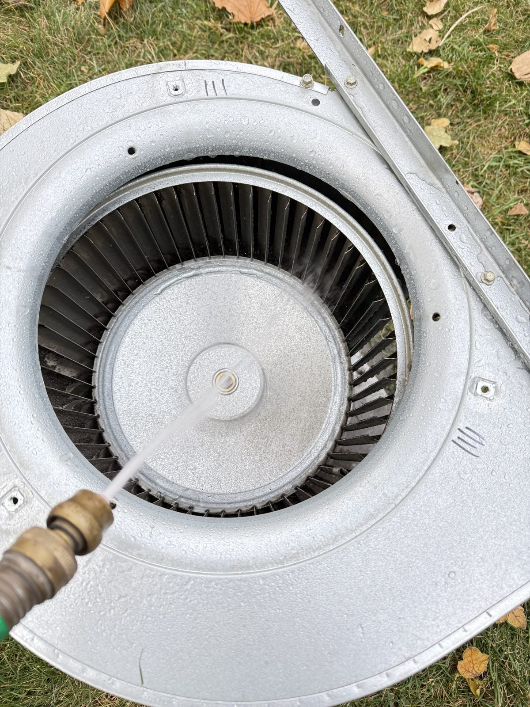

The air coming out of the registers feels weaker than last winter. The furnace runs, shuts off a little early, and comes back on. The filter is new, so what's going on?

Pretty often the answer is inside the blower: the wheel that pushes air through your house is caked with dust. That's what this one looked like before we washed it.

## What the blower wheel does and why it gets dirty

The blower wheel is the drum-shaped fan inside your furnace, usually right below or behind the filter. It has dozens of small, cupped blades. In winter it pushes air across the heat exchanger and out to the rooms. In summer the same wheel pushes air across the AC coil.

The filter is supposed to catch the dust first. But some always gets through, and a lot gets through when the filter is skipped for a season, doesn't fit the slot, or the filter door is missing. That dust sticks to the blades and builds up in the cups. A wheel with packed blades spins at the same speed but moves noticeably less air.

## Signs your blower wheel needs cleaning

- **Weak airflow** at the registers, even with a fresh filter.
- **The furnace shuts off early and restarts.** Without enough airflow it overheats and the high-limit switch cuts it off. See [why furnaces short-cycle](/furnace-short-cycling/).
- **A louder blower**, or a rumble or hum that wasn't there before.
- **Rooms far from the furnace stay cooler**, especially upstairs rooms in a bungalow or the back of a two-flat.
- **Dust you can see** on the blades when you look through the blower opening with a flashlight (power off).

## How we clean a blower wheel

This is the job in the photo: the blower assembly came out of the furnace and the wheel and housing were washed down outside.

1. **Power off.** The furnace switch and the breaker, then check that it's dead.
2. **Take the blower assembly out.** Disconnect the wiring, mark where it goes, remove the mounting bolts and slide the blower out.
3. **Keep the motor dry.** The motor comes out of the housing or is protected; water goes on the wheel and housing, not the motor.
4. **Wash it out.** Degreaser and water work the dirt out of every blade. A brush alone won't reach the inside of the cups.
5. **Let it dry completely**, then check the wheel is tight on the shaft and spins true.
6. **Reinstall and test:** wiring back the way it was, the furnace through a full heating cycle, and airflow checked at the registers.

While the blower is out, it's the right moment to look at the inside of the cabinet, the filter slot and the return side, because whatever let the dust in is still there.

## What you can do yourself

- **Change the filter on time** and make sure it's the right size for the slot, with the filter door closed. Our guide on [how often to change a furnace filter](/how-often-change-furnace-filter/) covers the details.
- **Look, don't take apart.** With the power off, a flashlight through the blower opening tells you whether there's buildup.
- **Vacuum what you can reach**, power off. That helps a little, but it won't clean the cups.
- **Leave removal to a technician** unless you're comfortable with wiring and mounting bolts. A wheel that's put back loose or off-center will shake and wear out the motor.

## How often does it need cleaning?

Less often than people think, if the filter is right. ENERGY STAR's [heating and cooling maintenance checklist](https://www.energystar.gov/saveathome/heating-cooling/maintenance-checklist) lists cleaning and adjusting the blower components as part of regular service, because airflow problems can reduce efficiency by up to 15 percent. The State of Illinois [home heating guide](https://keepwarm.illinois.gov/content/dam/soi/en/web/keepwarm/documents/heatingsystems.pdf) recommends tuning gas furnaces every year unless the manufacturer says otherwise.

In practice: have the blower looked at during the yearly [furnace tune-up](/furnace-tune-up/), and clean it when there's visible buildup. Homes with pets, recent renovation dust, or return ducts that pull air from a dusty basement need it more often. In those homes, sealing the [return ductwork](/ductwork-repair/) can do more than extra cleanings.

If your airflow has dropped or the furnace keeps shutting off early, [schedule a furnace check](/furnace-repair/). We look first and give you the price before any work starts.
