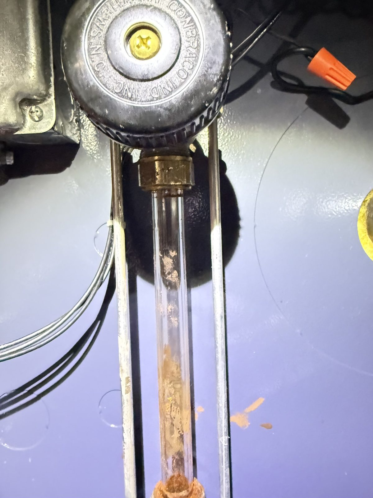
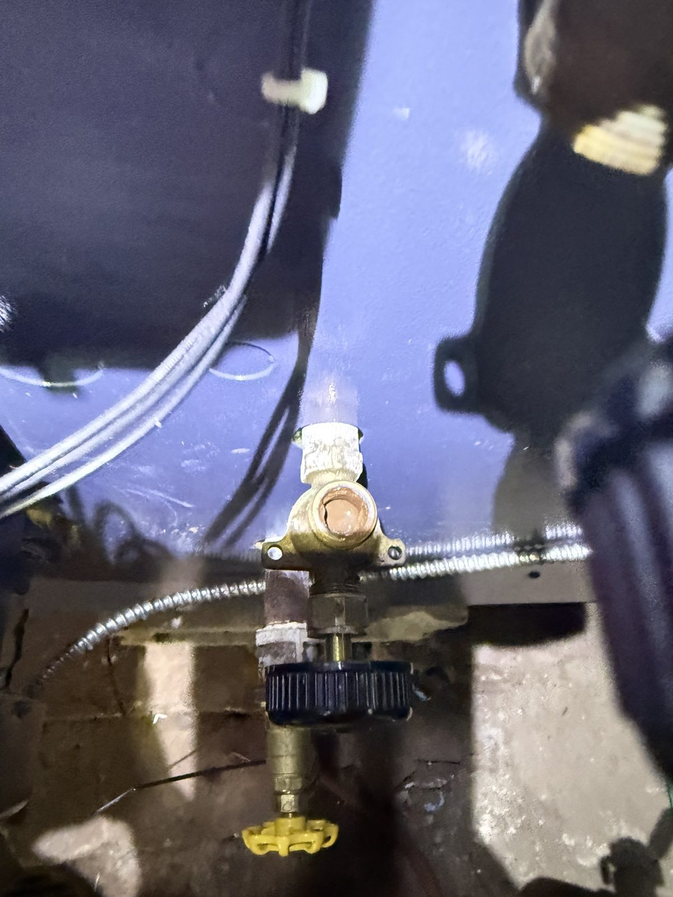
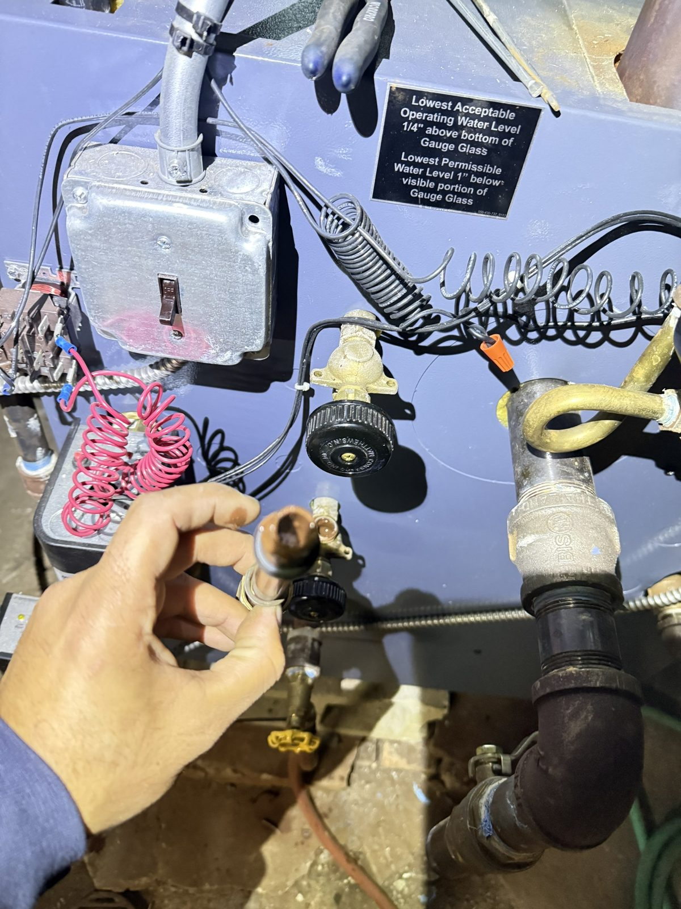

The call was simple: the steam boiler wasn't running and the house was getting cold. No error code, no loud noise, just a boiler that wouldn't come on.

What we found wasn't a failed burner or a dead control. It was rust. Sediment from years of old boiler water had built up in two small parts that most homeowners never think about: the **gauge glass** and the **pigtail**. We cleaned both, and the boiler started up again.

Here's what those parts do, what we saw, and what you can safely check on your own steam boiler.

## What we found: a gauge glass full of rust

The gauge glass (some people call it the sight glass) is the small glass tube on the side of a steam boiler. It shows you how much water is in the boiler. On this boiler, the plate right above it says it plainly: the lowest acceptable operating water level is 1/4 inch above the bottom of the glass.

You can see the problem in the photo. The glass was stained brown and packed with rust, so it couldn't show a clear water line. The valve at the bottom of the glass was worse: its opening was filled with sediment.

When those passages clog, the glass stops showing the real water level in the boiler. You might see water when the boiler is low, or the reading just never changes.

## The other clog: the pigtail

The pigtail is a looped pipe that connects the boiler to the pressure control (the pressuretrol) and the pressure gauge. The loop holds water so live steam never hits the control directly. It's a narrow pipe, and the same rust that fills a gauge glass collects in it.

When a pigtail clogs, the pressure control can't read what's going on inside the boiler. That's not something to ignore: the pressure control is one of the things that tells the burner when to run and when to stop.

## The fix

With the boiler off and cooled down, we took the clogged parts apart and cleaned them:

1. **Cleaned the gauge glass and its fittings** until the glass showed a clear water line again.
2. **Cleaned out the pigtail** so the pressure control could read the boiler properly.
3. **Checked the water level** against the plate on the boiler, put everything back together and ran the boiler through a heating cycle.

The boiler fired and ran. No new boiler, no expensive parts. Just two small passages that rust had closed up.

## What you can check on your own steam boiler

You don't need tools to keep an eye on the basics:

- **Look at the gauge glass.** You should see a clear water line, roughly in the middle. When the boiler is steaming, the line moves a little. Brown water or a stained glass where you can't see the level is a reason to call.
- **Never add water to a hot boiler that shows no water.** Shut it off and let it cool first. Cold water into a hot, dry boiler can crack it.
- **Flush the low-water cutoff the way your boiler's instructions say.** Many steam boilers have a float-type cutoff with a blowdown valve that's meant to be flushed regularly during the heating season.
- **Don't open fittings yourself on a hot or pressurized boiler.** Glass tubes break and scalding water sprays. Shut the boiler off and call.
- **Don't keep pressing reset buttons.** If the boiler locks out again and again, something is telling it to stop.

## Why this happens in older Chicago homes

A lot of Chicago two-flats, greystones and older single-family homes still heat with steam. These systems lose a little water over time and get fresh water added, and the old iron pipes and radiators shed rust into the boiler. Over years, that sediment settles in the boiler and finds the smallest openings first: the gauge glass fittings, the pigtail and the low-water cutoff.

A yearly boiler service is when this gets caught, before it shuts the boiler down on a cold night. If your steam boiler isn't running or the water in the glass looks rusty, see [boiler repair](/boiler-repair/) or our guide to [a boiler that's not heating](/boiler-not-heating/). Not sure whether you have steam or hot water? Here's [how to tell](/steam-vs-hot-water-boiler/).

We answer calls and texts 24/7, including nights and holidays.
